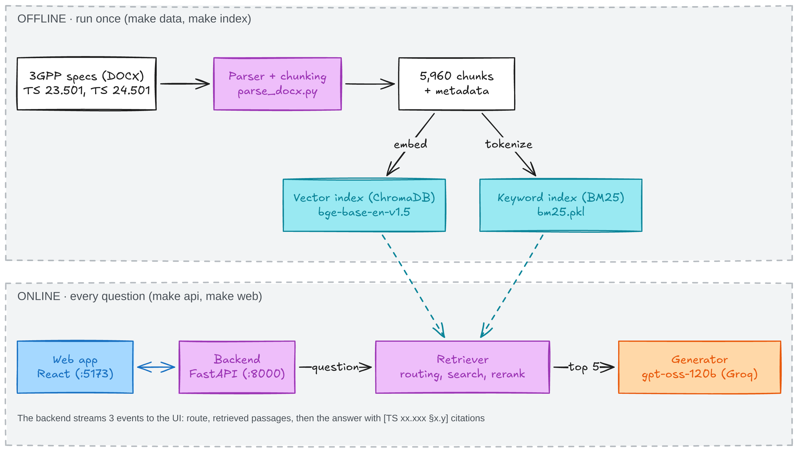
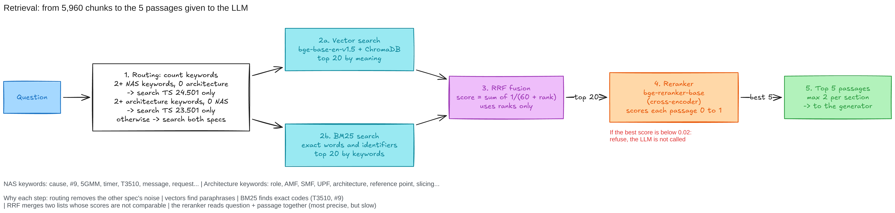
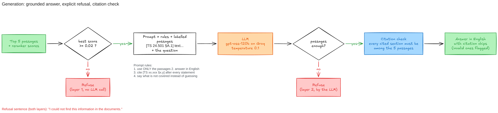

# How 5G Spec Assistant works

A guide for the team: what each part does, why we chose each model and tool, and what the evaluation showed.
Setup and launch instructions are in the [README](../README.md). Full evaluation results are in [EVALUATION.md](EVALUATION.md).

---

## In one minute

- The chatbot answers questions about 5G using **only two documents**: **TS 23.501** (5G architecture) and **TS 24.501** (NAS protocol), Release 18.
- For each question it **searches** the documents for the 5 most relevant passages, then asks an LLM to **answer only from those passages** and to **cite the section** after every statement.
- If nothing relevant is found, it answers *"I could not find this information in the documents."* instead of guessing.
- This approach is called **RAG** (Retrieval-Augmented Generation). It keeps answers checkable and avoids LLM hallucinations.

---

## 1. The big picture

The system has two halves:

| | When | What happens | Code |
|---|---|---|---|
| **Offline** | once (`make data`, `make index`) | Parse the 2 DOCX files into 5,960 chunks, then build 2 search indexes | `ingest/` |
| **Online** | every question | Search the indexes, keep the best 5 passages, ask the LLM, check the citations | `rag/`, `api/`, `web/` |

---

## 2. Ingestion: turning the specs into chunks

**Code:** `ingest/parse_docx.py` → `corpus/chunks.jsonl`

A **chunk** is a small passage (about 400 tokens ≈ 300 words) that can be searched on its own.

**How the parser works:**
1. It reads the DOCX in order and detects **section headings** from the Word styles (e.g. `5.5.1.2 Initial registration initiation`).
2. It takes the **section level from the clause number** (`5.5.1.2` = level 4, `A.1` = level 2), because Word styles are unreliable in the annexes.
3. It converts **tables to Markdown**, keeps **figure captions**, and removes noise: table of contents, empty "Void" clauses, change history.
4. It splits long sections into **~400-token chunks with 60 tokens of overlap**, so an idea cut at a boundary still appears whole in one chunk.
5. Every chunk carries **metadata**: spec, release, version, section number, title. **Citations come straight from this metadata**, so they can't be invented.

| Choice | Why |
|---|---|
| **DOCX, not PDF** | 3GPP publishes DOCX. Heading styles give exact section numbers, tables stay intact, and there are no page headers/footers to clean. |
| **Chunk by section, not every N characters** | A chunk never mixes two sections, so each one has one clear citation. |
| **400 tokens** | The embedding model reads at most **512 tokens**. With our first 800-token chunks, **52%** were silently cut off. At 400 tokens, only **2.5%** are. |
| **Images dropped** | 3GPP figures are always described in the text (e.g. the numbered steps of a call flow), and captions are kept. |

**Result:** 1,983 sections → **5,960 chunks** (2,197 from TS 23.501, 3,763 from TS 24.501).

---

## 3. Indexing: two ways to search the same chunks

**Code:** `ingest/build_index.py` → `index/`

### Vector index (search by meaning)
Each chunk is turned into a list of 768 numbers (an **embedding**) that represents its meaning. Texts with similar meaning get close vectors, even with different words ("UE attach" ≈ "registration").

| Option | Decision |
|---|---|
| **`BAAI/bge-base-en-v1.5`** ✅ | English (the project requires it), trained for question → passage search, among the best open models of its size, **runs on CPU**, free, local |
| `bge-small-en-v1.5` | faster but less accurate |
| `bge-large-en-v1.5` | more accurate but ~3× slower on CPU |
| `bge-m3` | multilingual, heavier: kept for the French-questions bonus |
| OpenAI / Cohere APIs | paid, and the data leaves the machine |

**Storage: ChromaDB.** Local, file-based, keeps vectors on disk, and supports **metadata filters** (needed for routing by spec). FAISS has no metadata or persistence built in; Qdrant and Milvus are heavier than we need.

### BM25 index (search by exact words)
BM25 is a classic keyword ranking: rare words count more than common ones. Our tokenizer **keeps 3GPP identifiers whole** (`t3510`, `5gmm`, `9.11.3.2`, `#9`), so an exact code is matched exactly instead of being split into meaningless pieces.

**Why both?** Vectors understand paraphrases but blur exact codes; BM25 nails codes but misses synonyms. In our first tests, vectors returned the wrong timer table for *T3510* while BM25 found the right one, and the opposite happened for *"the role of the AMF"*.

---

## 4. Retrieval: choosing the 5 passages

**Code:** `rag/retriever.py`

| Step | What it does | Key setting |
|---|---|---|
| **1. Routing** | Counts keywords in the question. NAS keywords (cause, #9, T3510, message, 5GMM…) point to TS 24.501; architecture keywords (role, AMF, slicing, reference point…) point to TS 23.501. | One spec only with **2+ keywords for it and 0 for the other**; otherwise both (e.g. *cause #9 … 5GMM* → 24.501; *role of the AMF* → 23.501; registration + NAS messages + AMF → both) |
| **2. Hybrid search** | Vector search and BM25 each return their top candidates | **20 + 20** |
| **3. RRF fusion** | Merges the two lists using **only ranks**, because cosine and BM25 scores aren't comparable: `score = Σ 1/(60 + rank)` | k = 60 |
| **4. Reranker** | A **cross-encoder** reads the question and each passage **together** and scores relevance from 0 to 1 | top 20 rescored |
| **5. Top 5** | Keeps the 5 best, at most 2 chunks from the same section (diversity) | k = 5 |

**Why a reranker?** Vector search compares two vectors computed *separately*: fast but approximate. The cross-encoder (`BAAI/bge-reranker-base`, same family as the embedder) reads both texts together, which is much more precise but too slow for 5,960 chunks. So it only rescores the top 20. **The evaluation shows it is the most valuable component** (see section 7).

**The reranker score** is a relevance value from 0 to 1, *not* a calibrated probability: use it to rank passages and to detect irrelevant ones (out-of-corpus questions score ~0.000).

> **Lesson from the evaluation:** routing first counted the word *procedure* as an architecture cue, which sent NAS questions such as *"How does the UE initiate the de-registration procedure?"* to the wrong spec. Procedures are described in both specs, so *procedure* is now neutral, and routing only filters on clear evidence. A wrong filter hides the right spec entirely, while searching both only costs a little precision.

---

## 5. Generation: answering with citations

**Code:** `rag/generator.py`

### The LLM: `openai/gpt-oss-120b` served by Groq
| Point | Detail |
|---|---|
| Why this model | The strongest model available on our Groq key; good at following strict rules (cite everything, refuse when unsure); 131k context |
| Where it runs | It's an **open-weight** model (published by OpenAI, Apache 2.0). It runs on **Groq's servers**, not OpenAI's: requests go to Groq only. |
| Why not local | 120B needs ~80 GB of GPU memory; even the 20B version would take minutes per answer on our CPU |
| Settings | temperature **0.1** (factual, near-deterministic), max 1,500 output tokens |
| Alternatives on the key | `gpt-oss-20b` (faster), `qwen3.8-27b` (other family): selectable in the app's Settings |

### Anti-hallucination, in 4 layers
1. **Grounded prompt:** use only the passages, answer in English, cite `[TS 24.501 §x.y]` after every statement, say what isn't covered.
2. **Refusal layer 1:** if the best reranker score is below **0.02**, nothing relevant was found → refuse **without calling the LLM**.
3. **Refusal layer 2:** the LLM itself refuses when the passages are insufficient.
4. **Citation check:** every cited section is compared with the 5 retrieved passages; any citation that wasn't retrieved is flagged (red chip in the UI).

> Caveat: a correct citation doesn't guarantee a correct paraphrase. Once, the LLM expanded *RM* as "radio resource" instead of *Registration Management*, with a valid citation. That's why the evaluation also grades faithfulness.

---

## 6. The app

| Part | Tech | Role |
|---|---|---|
| **Backend** (`api/server.py`) | FastAPI + uvicorn | Loads the models and indexes once, then streams 3 events per question: **route → passages → answer** (NDJSON) |
| **Frontend** (`web/`) | React + TypeScript + Vite | Chat with live stages, **clickable citation chips** that open the exact passage in the Sources panel, score and ranks per passage, Settings to switch hybrid search / reranker / routing / model |

The streaming makes the wait readable: the user sees the routing and the passages before the answer arrives (~10 s per answer on CPU, mostly the reranker).

---

## 7. What the evaluation showed

29 test questions (20 simple, 6 cross-spec, 3 out-of-corpus), with expected sections checked by hand. Details in [EVALUATION.md](EVALUATION.md).

| Result | Value |
|---|---|
| Right section in the top 5 (recall@5) | **0.88** |
| Out-of-corpus questions refused | **100%** |
| Faithfulness (judge) / valid citations | **100% / 100%** |
| Answer correctness (judge) | **0.87** (simple 0.93, cross-spec 0.67) |

**Takeaways:**
- **The reranker is the key component:** without it, the right section is first only 46% of the time instead of 65%.
- **No hallucination was detected:** errors are *omissions*, when the passage holding a fact isn't retrieved.
- **Cross-spec questions are the weak spot**, e.g. *"describe the registration procedure"*.
- **BM25 gives no measurable gain on this test set** once the reranker is used. It stays on: the project requires it, and it protects exact-identifier queries.

---

## 8. Known limits

- Broad procedure questions can miss the main clause (e.g. §5.5.1.2 for registration).
- ~10 s per answer on CPU, mostly the reranker; a GPU would bring it to ~1 s.
- A valid citation doesn't guarantee a correct paraphrase.
- Figures are not indexed (captions only).
- Routing rules and the 0.02 threshold were set by hand.

---

## 9. Glossary

| Term | Meaning |
|---|---|
| **RAG** | Retrieval-Augmented Generation: search first, then let the LLM answer from what was found |
| **Chunk** | A searchable passage (~400 tokens) with its section metadata |
| **Token** | A word or piece of a word (~4 characters of English) |
| **Embedding** | A vector of numbers representing the meaning of a text |
| **BM25** | Keyword ranking where rare words weigh more |
| **RRF** | Reciprocal Rank Fusion: merges ranked lists using ranks only |
| **Cross-encoder / reranker** | A model that reads question + passage together and scores relevance |
| **Recall@k** | % of questions whose correct section is in the top k results |
| **MRR** | Mean Reciprocal Rank: average of 1/rank of the first correct section (1.0 = always first) |
| **Faithfulness** | Everything the answer says is supported by the retrieved passages |
